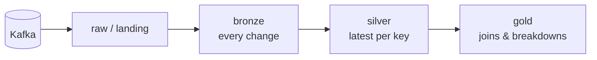

# data-engineering-cookiecutter

A [cookiecutter](https://github.com/cookiecutter/cookiecutter) template for **Kafka → medallion** pipelines.
When generating a project you pick one target: **Postgres**, **Snowflake** or **Databricks**. You get a
project written the way that platform is normally used, built on open-source components.



| Layer  | Semantics |
|--------|-----------|
| bronze | Append-only change log: one row per Kafka message, typed columns + `_op`, `_is_deleted`, `_source_ts_ms` and Kafka metadata. Idempotent, so re-runs never duplicate. |
| silver | The latest version of each primary key. Out-of-order and replayed events never overwrite newer data. Deletes are soft (`_is_deleted`). |
| gold   | Hand-written models that join silver tables (`fct_orders`) or break one down (`dim_customer_addresses`). |

## Usage

```bash
pip install cookiecutter
cookiecutter gh:<owner>/data-engineering-cookiecutter
# or non-interactively
cookiecutter gh:<owner>/data-engineering-cookiecutter --no-input target=snowflake payload_format=debezium
```

| Option | Values | Meaning |
|--------|--------|---------|
| `project_name` / `project_slug` | | Names; the slug is used for the dbt project, bundle, database names |
| `target` | `postgres`, `snowflake`, `databricks` | Platform plugin to generate |
| `payload_format` | `debezium`, `json` | Debezium CDC envelope (ordered by `ts_ms`), or plain JSON rows with tombstone deletes (ordered by Kafka offset) |
| `streaming_engine` | `none`, `flink` | `flink`: an Apache Flink job keeps bronze/silver continuously up to date (seconds of latency). Postgres only, see below |
| `orchestrator` | `dagster`, `none` | `dagster`: open-source Dagster assets, schedules and sensors; dbt tests become asset checks |
| `topic_prefix` | `app.public` | Topic prefix for the example entities |
| `raw_schema` | `raw` | Landing schema for raw Kafka records |

## What each target generates

| Target | Kafka → raw / bronze | bronze → silver | gold | Tests |
|--------|----------------------|-----------------|------|-------|
| **Postgres** | Python consumer ([confluent-kafka](https://github.com/confluentinc/confluent-kafka-python) + [psycopg 3](https://www.psycopg.org/)), idempotent on `(partition, offset)`, dead-letter table | [dbt-postgres](https://github.com/dbt-labs/dbt-postgres) incremental | dbt models | End-to-end on Kafka + Postgres via [Testcontainers](https://testcontainers.com/) |
| **Snowflake** | [Snowflake Kafka Connector](https://github.com/snowflakedb/snowflake-kafka-connector) (Snowpipe Streaming); connector config generated | [dbt-snowflake](https://github.com/dbt-labs/dbt-snowflake) incremental `merge` | dbt models | Offline: connector config + `dbt parse` |
| **Databricks** | [Spark Structured Streaming](https://spark.apache.org/streaming/) → [Delta Lake](https://delta.io/) | Streaming `foreachBatch` + Delta `MERGE` | Spark SQL files | Local Spark + Delta, run the real streaming code |

### Streaming engine (`streaming_engine=flink`)

[Apache Flink](https://flink.apache.org/) 1.20 (LTS) replaces the micro-batch bronze/silver build. One Flink SQL job,
generated from `config/pipeline.yml`, reads the topics and writes:

- bronze: append-only, idempotent upsert on `(partition, offset)`;
- silver: Top-N latest-per-key upsert, safe against out-of-order events, soft deletes.

Both go into Postgres through the JDBC connector, a few seconds behind Kafka. dbt keeps building gold and running the
tests. Locally the stack is Kafka, Postgres and a Flink session cluster in Docker Compose.

| Target | Flink | Why / alternative |
|--------|-------|-------------------|
| Postgres | Supported | Fully open source and tested end to end. |
| Snowflake | Rejected | No supported Flink → Snowflake sink. Use Snowpipe Streaming (the default) with Dynamic Tables for low latency. |
| Databricks | Rejected | Flink's Delta sink is append-only and can't upsert silver. Spark Structured Streaming with a short trigger gives seconds-level latency. |

### Orchestrator (`orchestrator=dagster`)

[Dagster](https://dagster.io/) (Apache-2.0, self-hosted; the paid Dagster+ is not needed) models raw, bronze, silver
and gold as assets with lineage:

- Postgres and Snowflake use `dagster-dbt`, so every dbt model is an asset and every dbt test is an asset check.
- Databricks triggers the Asset Bundle job.
- With Flink, a sensor watches that the Flink job is running.

`make dagster` starts the UI.

Every generated project contains:

- `config/pipeline.yml`: the single source of truth. Each entity has a topic, primary key and typed columns.
- `make generate` / `make check-generated`: validate the config and regenerate the derived files (dbt
  bronze/silver models and tests, Snowflake connector config).
- `compose.yaml`: local Kafka (plus Postgres for the Postgres target), and a deterministic sample-event
  producer (`make sample-phase1`, `make sample-phase2`).
- `docs/target.md`: setup and operations for the chosen target.
- A GitHub Actions workflow.

## How the template is organised (plugin contract)

```
cookiecutter.json
hooks/post_gen_project.py          overlays the selected plugins onto the project, deletes the rest, runs the generator
{{cookiecutter.project_slug}}/
  config/pipeline.yml               ┐
  scripts/generate.py               │ common to every target
  scripts/produce_sample_events.py  │
  compose.yaml  Makefile  README.md ┘
  targets/
    postgres/  snowflake/  databricks/   ← one self-contained plugin per target
  engines/flink/postgres/              ← optional streaming engine, per supported target
  orchestrators/dagster/common/        ← optional orchestrator: shared part
  orchestrators/dagster/<target>/      ←                         target-specific part
```

Plugins are overlaid in this order: target, engine, orchestrator. A plugin can add files, and it can delete files
listed in its `_remove.txt` (Flink removes the batch loader this way), but it can never overwrite one. Plugins add make
targets through `target.mk`, `engine.mk` and `orchestration.mk`, and Docker services through `compose.*.yaml` files.

A plugin mirrors the project layout. Its files are added to the generated project; it may not overwrite common
files. Every plugin provides:

| File | Purpose |
|------|---------|
| `target.mk` | Make targets: at least `install` and `test` (plus e.g. `ingest`, `transform`, `deploy`); included by the common `Makefile` |
| `scripts/plugin_generate.py` | `MANAGED_GLOBS` and `render(pipeline) -> {path: content}` for files derived from `pipeline.yml` |
| `requirements.txt`, `requirements-dev.txt` | Runtime and test dependencies |
| `.env.example` | Environment variables the project reads |
| `docs/target.md` | Target documentation |
| `.github/workflows/ci.yml` | CI for the generated project |
| `tests/` | Tests run by `make test` |
| `compose.override.yaml` *(optional)* | Extra local services, merged automatically by `docker compose` |

### Adding a target (e.g. BigQuery, ClickHouse, Iceberg)

1. Create `{{cookiecutter.project_slug}}/targets/<name>/` with the files above. Copying the closest existing plugin
   is the fastest start.
2. Add `<name>` to `target` (and a prompt) in `cookiecutter.json`.
3. If the plugin ships files with Jinja or `${...}` that cookiecutter must not render, add them to
   `_copy_without_render`.
4. Add `<name>` to the matrix in `.github/workflows/ci.yml` and to `TARGET_FILES` / `TARGET_MARKERS` in
   `tests/test_bake.py`.

## Developing the template

```bash
pip install -r requirements-dev.txt
pytest tests                      # renders every target x format and checks the output
```

CI also generates projects for each target × payload format, with Dagster, plus the Flink and no-orchestrator
variants. It runs each project's own `make check-generated` and `make test`:

- Postgres (batch and Flink) end-to-end tests on Docker;
- Databricks local Spark tests;
- Snowflake offline checks;
- Dagster definition tests, plus a real Dagster job run on Postgres.

## Local environment: why Docker Compose + Testcontainers

Kafka and Postgres run well in Docker. Compose is the simplest way to get a local stack, and Testcontainers gives
each test run its own throwaway Kafka and Postgres. Snowflake and Databricks are hosted services and can't run
locally. Their projects are tested offline: generated config checks and `dbt parse` for Snowflake, local Spark +
Delta for Databricks. They run for real against your accounts. In production, use a managed Kafka or Kubernetes
with [Strimzi](https://strimzi.io/) rather than Compose.
