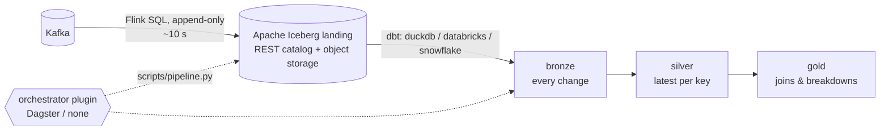

# data-engineering-cookiecutter

A [cookiecutter](https://github.com/cookiecutter/cookiecutter) template for **Kafka → lakehouse → medallion**
pipelines. The design goal is to **land data as soon as possible in an open format**, and keep the warehouse and
the orchestrator replaceable plugins.



## Contracts, not wiring

| Contract | What is fixed | What plugs in |
|----------|---------------|---------------|
| **Landing** | One append-only Iceberg table per topic: raw key/value plus Kafka metadata, written by a generated Flink SQL job | Kafka cluster, object storage |
| **Catalog** | Iceberg REST API | Apache Polaris / Snowflake Open Catalog, Unity Catalog, AWS Glue, Lakekeeper, … (env vars only) |
| **Transform** | One dbt project: bronze (typed change log) → silver (latest per key) → gold | dbt adapter + 5 small macros (`dbt/macros/adapter_<target>.sql`) |
| **Run** | `scripts/pipeline.py ingest deploy\|status\|cancel`, `transform`, `check` | Any orchestrator calls these |

Why these choices:

- **Iceberg landing.** Data lands within seconds in an open format that Databricks, Snowflake, DuckDB, Trino and
  Spark all read.
- **Append-only.** Landing never writes Iceberg row-level deletes, which Databricks and Snowflake handle
  inconsistently. All deduplication and latest-per-key logic runs in dbt on the target.
- **Raw landing.** Payload or schema changes can never break ingestion. Typing happens in bronze.
- **Flink SQL.** Flink commits to Iceberg exactly once on each checkpoint. It's deployed through the Flink SQL
  Gateway REST API, so the same job runs on a local cluster, Kubernetes or a managed Flink service.

## Usage

```bash
pip install cookiecutter
cookiecutter gh:<owner>/data-engineering-cookiecutter
# or non-interactively
cookiecutter gh:<owner>/data-engineering-cookiecutter --no-input target=snowflake orchestrator=dagster
```

| Option | Values | Meaning |
|--------|--------|---------|
| `target` | `duckdb`, `databricks`, `snowflake` | Where dbt builds bronze/silver/gold from the Iceberg landing tables |
| `orchestrator` | `dagster`, `none` | `dagster`: open-source Dagster with landing/bronze/silver/gold assets, dbt tests as asset checks, schedule and landing-job sensor |
| `payload_format` | `debezium`, `json` | Debezium CDC envelope (ordered by `ts_ms`), or plain JSON rows with tombstone deletes (ordered by offset) |
| `topic_prefix` | `app.public` | Topic prefix for the example entities |
| `landing_namespace` | `landing` | Iceberg namespace of the landing tables |

| Target | Reads landing via | Tested here |
|--------|-------------------|-------------|
| **DuckDB** | `ATTACH … (TYPE iceberg)` on the REST catalog | Full end to end on the local lakehouse: Kafka → Flink → Iceberg → dbt → gold |
| **Databricks** | Unity Catalog. Flink writes through UC's Iceberg REST endpoint | Offline: `dbt parse`, compiled SQL, Dagster definitions |
| **Snowflake** | Catalog integration + external volume, `CREATE ICEBERG TABLE … AUTO_REFRESH` (generated) | Offline: `dbt parse`, compiled SQL, Dagster definitions |

The local lakehouse in every generated project is all open source and runs in Docker Compose: Apache Kafka,
Apache Flink with its SQL Gateway, the Apache Iceberg REST catalog, and RustFS (S3-compatible storage).

## Template layout

```
cookiecutter.json
hooks/post_gen_project.py           overlays the selected plugins, deletes the rest, runs the generator
{{cookiecutter.project_slug}}/      target-agnostic core: ingestion/, dbt/, scripts/, config/, compose.yaml
  targets/duckdb|databricks|snowflake/   dbt profile, adapter macros, requirements, docs, tests
  orchestrators/dagster/                 orchestration code, make targets, docs, tests
```

Plugins mirror the project layout. A plugin may **add** files, and `<file>.append` is appended to an existing
file (`requirements.txt`, `.env.example`). It may never overwrite a core file.

### Adding a target (e.g. BigQuery, Trino, ClickHouse)

1. `targets/<name>/dbt/profiles.yml`, plus `dbt/macros/adapter_<name>.sql` implementing `json_object`,
   `json_text`, `ts_from_iso` and `ts_from_epoch` (and `landing_col` if columns need quoting).
2. `requirements.txt.append` (the dbt adapter), `.env.example.append` (`LANDING_DATABASE`/`LANDING_SCHEMA` and
   credentials), `target.mk`, `docs/target.md`, `tests/`.
3. Optional: `scripts/plugin_generate.py` for generated target-side DDL (see the Snowflake plugin).
4. Add `<name>` to `target` in `cookiecutter.json`, and to the test lists and CI matrix.

### Adding an orchestrator (e.g. Airflow, Prefect)

Create `orchestrators/<name>/` that calls `scripts/pipeline.py` (or the dbt project), plus `requirements.txt.append`,
docs and tests. Then add it to `orchestrator` in `cookiecutter.json`.

## Developing the template

```bash
pip install -r requirements-dev.txt
pytest tests          # renders every combination, checks generated output and the generator
```

CI also generates projects and runs each project's own `make check-generated && make test`: the DuckDB end-to-end
lakehouse test, plus offline checks for Databricks and Snowflake.
