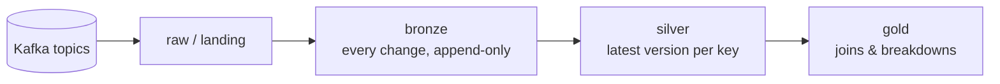

# {{ cookiecutter.project_name }}

Kafka → **{{ cookiecutter.target }}** medallion pipeline, generated from the data-engineering cookiecutter.



| Layer  | Contents | Guarantees |
|--------|----------|------------|
| bronze | One row per Kafka message ({{ cookiecutter.payload_format }} payload), typed columns + `_op`, `_is_deleted`, `_source_ts_ms`, `_kafka_topic/_partition/_offset/_timestamp`, `_ingested_at` | Append-only, idempotent on (partition, offset): re-runs never duplicate |
| silver | Latest change per primary key | Out-of-order and replayed events never overwrite newer data; deletes are soft (`_is_deleted = true`) |
| gold   | Hand-written models joining silver tables (`fct_orders`, `customer_order_summary`) or splitting one (`dim_customer_addresses`) | Exclude deleted rows |

Which change is the latest: Debezium `ts_ms`, then Kafka offsetKafka offset. Producers must key messages by primary key, so each key stays in one partition.

Target-specific details (setup, operations): **[docs/target.md](docs/target.md)**.

Streaming engine (Apache Flink keeps bronze/silver continuously up to date): **[docs/streaming.md](docs/streaming.md)**.


Orchestration (Dagster, open source; `make dagster`): **[docs/orchestration.md](docs/orchestration.md)**.


## Quick start

```bash
python -m venv .venv && source .venv/bin/activate
make install
cp .env.example .env
make help
```

`make up` starts a local Kafka (plus Postgres for the Postgres target) with Docker Compose.
`make sample-phase1` / `make sample-phase2` produce a deterministic set of customer/order changes
(creates, updates, a delete and an out-of-order replay) for trying the pipeline out.

## Add or change an entity

1. Edit `config/pipeline.yml`: topic, primary key, typed columns.
2. `make generate`: validates the config and regenerates the derived files. CI runs `make check-generated`.
3. Add or adjust gold models.

Supported column types: `string, integer, bigint, double, boolean, date, timestamp` (ISO-8601),
`timestamp_ms`, `timestamp_us` (epoch), `decimal(p,s)`.

The `customers` / `orders` entities and the gold models are examples. Replace them with your own.

## Layout

```
config/pipeline.yml        single source of truth (entities, payload format)
scripts/generate.py        validates config, runs the target generator (scripts/plugin_generate.py)
scripts/produce_sample_events.py
compose.yaml               local Kafka (target services in compose.override.yaml)
target.mk                  target-specific make targets (included by Makefile)
docs/target.md             target-specific documentation
```
